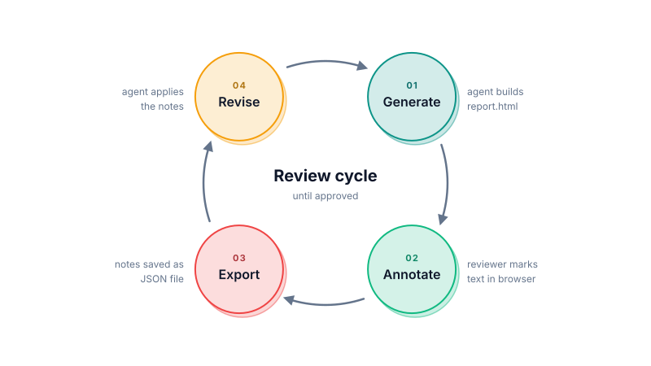

# design-pack

> **Renamed from `html-template-pack` (2026-10-18, v0.25.0).** GitHub redirects git traffic and repo links from the old URL, but the old Pages address (`cheahhl814.github.io/html-template-pack/`) does NOT redirect — use `https://cheahhl814.github.io/design-pack/`.

[](https://opensource.org/licenses/MIT)
[](https://cheahhl814.github.io/design-pack/)
[](#-installation)
[](https://github.com/genspark-ai/genoffice)

**The design layer for [GenOffice](https://github.com/genspark-ai/genoffice).** GenOffice creates, converts and edits the documents (docx, pptx, xlsx, pdf, md, html); design-pack supplies what they look like:

- a **128-component SVG diagram/infographic library** that **recolours to the document it goes into** — a slide-set palette, a tokens JSON, or the theme of your own `.pptx`/`.docx` (`svg-export.js --palette`);
- **13 SVG slide-design theme sets** (7 designs + 32 backgrounds + infographics and info-cards) bridged into **native, editable GenOffice `.pptx` decks** — design art as PNG, titles and body as real text boxes (`bin/genoffice-bridge.js`), with composer text-budget and graphic-dominance gates; a PNG + vector-PDF fallback for pixel-exact decks;
- one **themed report template** (v2 annotations, theme toggle, zero-dependency CSS graphics pack) whose rendered PDF GenOffice produces.

> ⚠️ **GenOffice is a mandatory dependency** — the app (provides the `genoffice` CLI) *and* its skill ([`skills/genoffice/SKILL.md`](https://github.com/genspark-ai/genoffice/blob/main/skills/genoffice/SKILL.md)). `node bin/preflight.js` checks both. **v1.0.0 retired** the HTML-first family (`design-pack-html`, bento one-pager, htmx dashboard): the last version that has them is tag [`v0.37.0-final`](https://github.com/cheahhl814/design-pack/tree/v0.37.0-final).

**Repository**: https://github.com/cheahhl814/design-pack

## 🧩 Skills (v1.0.0)

| Skill name | Directory | Covers |
|---|---|---|
| `design-pack` | `SKILL.md` (root) | router: preflight, routing, report recipe |
| `design-pack-svg` | `svg/SKILL.md` | diagram library + recolouring, slide designs, genoffice bridge, PNG/PDF fallback |

`svg/` holds symlinks (`bin`, `templates`, `features`, `docs`) to the shared copies at the repo root, so it can be linked on its own: `ln -s <repo>/svg ~/.agents/skills/design-pack-svg`. Integration findings: [`references/genoffice-integration.md`](./references/genoffice-integration.md). Release notes: [`references/history.md`](./references/history.md).

## 🎨 Recolour a diagram to its document (v1.0.0)

Library components are token-driven (`var(--teal,#0d9488)` …); the built-in fallbacks are the **Lab** palette. The exporter bakes any other palette into plain hex, so a diagram matches the deck or document it lands in:

```bash
node bin/svg-export.js mind-map --palette swiss --png            # a slide set's colours + fonts
node bin/svg-export.js mind-map --palette brand.json --png       # any subset of the tokens
node bin/svg-export.js mind-map --palette my-deck.pptx --png     # the pptx/docx/xlsx's own theme (accent1-6, dk/lt, fonts)
```

Colours from an Office theme are matched to the nearest hue role (coral / green / teal / deep-blue / amber); the exporter warns when text falls under 4.5:1 or marks under 3:1 against the surface. Then place the PNG with genoffice (`docs apply insert_image`, `slides apply addPicture`) — genoffice's deck specs take PNG, not SVG.

## 🏗️ Native decks through GenOffice (v1.0.0)

```bash
node bin/preflight.js
node bin/genoffice-bridge.js deck.json --render     # deck.json: {"set":"swiss","theme":"light","slides":[{"design":"title-hero","payload":{…}}, …]}
```

Per slide: composer gates → art PNG (text removed) + native GenOffice text boxes at the slot geometry → `genoffice create --type pptx` → `slides audit` (+ `render`). Edit the result with genoffice (`slides read` / `slides apply`). Same payload format as `compose-slide.js`; 1280×720 designs only.

## 🖍️ SVG diagram library (v0.16.0; 128 components)

128 **hand-drawn inline SVG infographic templates** for concept/summary diagrams — a sibling to the CSS graphics pack below. Canonical files in [`features/graphics/svg-library/svg/`](./features/graphics/svg-library/) with a generated, token-driven **preview gallery** ([`gallery.html`](./features/graphics/svg-library/gallery.html), ◐ theme toggle): pick a component, copy the inline `<svg>`, edit the `<text>` labels.

`flow-pipeline` · `cycle-loop` · `hub-spoke` · `pyramid-hierarchy` · `venn-overlap` · `quadrant-matrix` · `funnel-stages` · `roadmap-timeline` · `fishbone-causal` · `layer-stack` · `target-bullseye` · `staircase-steps` · `chevron-progression` · `iceberg-depth` · `balance-scale` · `radar-spider` · `journey-map` · `converging-forces` · `puzzle-pieces` · `gear-mechanism`  \
`timeline-vertical` · `swimlane-gantt` · `honeycomb-cluster` · `dual-hub` · `petal-cycle` · `decision-tree` · `snake-path` · `onion-layers` · `pillars-foundation` · `versus-columns` · `lightbulb-layers` · `matrix-nine-box` · `s-curve-adoption` · `growth-tree` · `spiral-growth` · `domino-chain` · `network-mesh` · `merge-paths` · `five-w-agenda` · `orbit-satellites` · `metro-map`  \
`hanging-tags` · `helix-ribbon-timeline` · `ring-chain` · `semicircle-segments` · `wavy-timeline` · `pictogram-grid` · `mind-map` · `eight-step-ring` · `radial-bars` · `org-chart` · `world-dot-map` · `europe-tile-grid`  \
`warming-stripes` · `climate-zones-globe` · `sector-landscape` · `sea-level-rise` · `carbon-cycle` · `thermometer-gauge` · `energy-mix-icons` · `planet-actions`  \
`dna-helix-steps` · `central-dogma` · `cell-to-dna-zoom` · `lab-glassware-steps` · `cell-membrane` · `punnett-square` · `mutation-types` · `gel-electrophoresis` · `well-plate-layout` · `scientific-method`  \
`cladogram-ladder` · `cladogram-anatomy` · `cladogram-matrix` · `nested-clades` · `circular-cladogram` · `cladogram-styles`  \
`food-web` · `trophic-pyramid` · `water-cycle` · `nitrogen-cycle` · `symbiosis-types` · `ecological-succession` · `ocean-zones`  \
`plate-boundaries` · `reaction-coordinate` · `states-of-matter` · `em-spectrum` · `crispr-editing` · `immune-response` · `pcr-thermal-cycle` · `transformer-block` · `api-request-lifecycle`  \
`protocol-loop-steps`  \
**Animated (17, SMIL-only, frame 0 = rest state):** `anim-flow-pipeline` · `anim-stepper` · `anim-radial-gauge` · `anim-loader-ring` · `anim-sequence-lifelines` · `anim-cycle-loop` · `anim-gear-mechanism` · `anim-domino-chain` · `anim-central-dogma` · `anim-dna-helix-steps` · `anim-pcr-thermal-cycle` · `anim-s-curve-adoption` · `anim-journey-map` · `anim-snake-path` · `anim-water-cycle` · `anim-food-web` · `anim-carbon-cycle`  \
**Computers & programming (v0.31–v0.32):** `cli-pipeline` · `prompt-anatomy` · `directory-tree` · `git-branch-merge` · `git-stage-flow` · `stack-heap-memory` · `async-event-loop` · `compile-pipeline` · `terminal-window` · `code-block`  \
**Framework/governance (v0.33–v0.35):** `three-node-roles` · `three-node-handoff` · `network-governance` · `phase1-reference-genomes` · `phase2-population-baselines`

Every file: `role="img"` + `aria-label` + `<title>`, id-free markup (safe to paste several into one page), token-driven colors wired via `style` attributes (`var(--token, #fallback)` + `color-mix()` — adapts to every template palette and both themes with zero edits), constant 800×450 `viewBox`. Conventions and the add-a-component workflow: [`features/graphics/svg-library/README.md`](./features/graphics/svg-library/README.md). Regenerate the gallery with `node bin/build-svg-gallery.js`. **Need just the graphic, no page?** `node bin/svg-export.js <name|file.svg> [--theme dark] --out <dir>` writes a standalone `.svg` with the palette baked in, which renders in PowerPoint, Word, Figma and Inkscape.

## 🎞️ SVG slide designs + composer (v0.21.0; theme sets v0.24.0; the only deck toolchain since v0.26.0)

All decks (any length, any ask) are composed here as **slide designs** drawn as SVG in the svg-library style — real design, not layout chrome. The seven slide designs live in [`templates/svg-slides/sets/`](./templates/svg-slides/), in **thirteen theme sets**, with a generated, token-driven [`gallery.html`](./templates/svg-slides/gallery.html). Since v0.28.0 the lab set also ships **5 infographic/info-card templates** (multi-section web/A4/print canvases — see [`templates/svg-slides/README.md`](./templates/svg-slides/README.md)):

`title-hero` · `section-break` · `big-statement` · `content-two-col` · `full-diagram` · `closing` · `diagram-hero`

**Graphic dominance (v0.36.0).** `diagram-hero` gives the diagram a 1224×610 slot under a heading strip, so a 16:9 library component covers about 72% of the slide. The composer gate `GRAPHIC-TOO-SMALL` enforces a minimum graphic share: it is on for `diagram-hero` (`data-graphic-min="0.667"`) and opt-in for any design via `--graphic-min 0.667`; the older `full-diagram` (about 49%) and `content-two-col` (about 21%) deliberately do not meet it.

Each design is a complete 1280×720 slide whose text and graphic areas are marked as **slots** (`data-slot` groups with a box, a type and a per-line character budget). `bin/compose-slide.js` fills them from a JSON payload and writes one renderer-safe composed `.svg`, colours baked to hex for light or dark, with svg-library components inlined into graphic slots.

```
node bin/compose-slide.js content-two-col --payload payload.json --theme light --out slides/
```

**Gates.** Text is never auto-wrapped: you break the lines, and the composer fails with `TEXT-OVERFLOW`, `SLOT-UNKNOWN`, `SLOT-MISSING` (and friends) instead of shipping a broken slide.

**Background designs (v0.22.0).** Eight slot-free, full-bleed stages (`bg-helix-field` · `bg-mosaic-triangles` · `bg-flow-dashes` · `bg-concentric-vortex` · `bg-dot-wash` · `bg-molecule-scatter` · `bg-orbit-arc` · `bg-slat-panel`) for graphic-only or text slides: compose with an empty payload (`--payload '{}'`), and the motif keeps a documented content zone clear.

**Theme sets (v0.24.0; 7 more in v0.30.0).** Every design comes in thirteen sets that share one slot contract, so one payload re-themes a deck with `--set`:
- `lab` (default): hand-drawn science.
- `swiss`: International Typographic Style, with red colour blocks.
- `boardroom`: generic consulting, navy plus one accent, serif titles.
- `editorial`: cream-paper magazine, serif, terracotta.
- `bold`: saturated geometric polygons with heavy display type.
- `brutalist`: neo-brutalism — acid fields, thick black borders, hard offset shadows, mono annotations.
- `academia`: dark academia — warm near-black, antique-gold serif, double inset frame.
- `terminal`: dev console — green-on-black mono, code-panel left bars, prompt cues, faint grid.
- `cyberpunk`: HUD — outline-only titles, corner brackets, cyan/magenta on near-black.
- `glass`: glassmorphism — frosted cards over a deep glow-blob field.
- `mesh`: gradient mesh — painterly pastel blob field, haloed display type.
- `deco`: art deco luxe — gold frames, corner sunbursts, stepped collars.
- `nordic`: nordic organic — warm cream, low-opacity blobs, huge whitespace.

The theme sets are researched from professional theme examples (composition and palette cues only) and are drawn by `bin/draw-slide-sets.js` — the v0.30.0 batch from two curated style-spec libraries (30-style `pptx-design-styles` + 12-preset slides-ai presets). A test fills every slot to its budget and measures it in Chrome.

```
node bin/compose-slide.js title-hero --set editorial --payload payload.json --theme dark --out slides/
```

Slot spec, layout rule, per-design slot tables and the add-a-design workflow: [`templates/svg-slides/README.md`](./templates/svg-slides/README.md).

## Contents

- [Skills](#-skills-v100) · [Recolour a diagram](#-recolour-a-diagram-to-its-document-v100) · [Native decks](#️-native-decks-through-genoffice-v100)
- [SVG diagram library](#️-svg-diagram-library-v0160-128-components) · [SVG slide designs + composer](#️-svg-slide-designs--composer-v0210-theme-sets-v0240-the-only-deck-toolchain-since-v0260)
- [Live demo](#-live-demo) · [Installation](#-installation) · [Usage examples](#-usage-examples)
- [What this skill does](#-what-this-skill-does) · [Annotation system](#-annotation-system-report) · [Theme toggle](#-theme-toggle) · [Density and font-size toggles](#-density-and-font-size-toggles-report)
- [Graphics pack](#-graphics-pack-v080) · [LaTeX equations](#-latex-equations-codecogs-v090) · [Hard invariants](#-hard-invariants)

## 🚀 Live demo

Static galleries deployed on GitHub Pages — no setup, no backend.

| | |
|---|---|
| 🌐 **Launcher** | https://cheahhl814.github.io/design-pack/ |
| 📄 **[Report demo](https://cheahhl814.github.io/design-pack/report/)** | "Q3 Operations Review — Northwind Logistics" (5 tabs, annotations; the source whose PDF genoffice renders) |
| 🧩 **[Components demo](https://cheahhl814.github.io/design-pack/components/)** | The CSS graphics pack in one page — donut, gauge, bars, heatmap, flow, compare, pull-quote, motion legend |
| 🖍️ **[SVG library demo](https://cheahhl814.github.io/design-pack/svg-library/)** | All 128 SVG diagram templates (incl. 17 SMIL-animated), token-driven, with source blocks — ◐ toggle previews both palettes |
| 🎞️ **[SVG slides gallery](https://cheahhl814.github.io/design-pack/svg-slides/)** | 13 theme sets × 9 designs: the slides that `genoffice-bridge.js` turns into native pptx decks |

Try the **◐ theme toggle**, **▤ density toggle** and **S/M/L font-size toggle** in the report demo; leave notes by selecting text. (The bento and dashboard demos were removed in v1.0.0.)

**Source files** (for starting your own document): see [`templates/`](./templates/) and follow the usage examples below.

## 🛠️ Installation

This is an **agent skill**, not a user-facing library. The skill is loaded by the agent harness at startup.

**To install, give your AI agent this prompt:**

```
Import the following skill: https://github.com/cheahhl814/design-pack
```

**Required first:** install the **GenOffice app** (it provides the `genoffice` CLI) and the **genoffice skill** ([`SKILL.md`](https://github.com/genspark-ai/genoffice/blob/main/skills/genoffice/SKILL.md)) into your harness's skills directory (e.g. `~/.agents/skills/genoffice`); then run `node bin/preflight.js` in this repo — it checks the CLI (≥ 0.9.0), the skill and Chrome, and exits 1 with install pointers if anything is missing.

Also needed: `node`, Chrome/Chromium (PNG art), `unzip` (for `--palette file.pptx`), and optionally `pdfunite` (poppler-utils) for the fallback merged deck PDF.

Once installed, the skill is **auto-invoked**: ask the agent for a slide deck, an SVG diagram or infographic, or a report PDF and it routes here, runs the preflight, and builds the file through GenOffice.

## 💡 Usage examples

### Slash commands and explicit invocation

Different agent harnesses use different mechanisms to force-load a skill. Use whichever matches your setup:

| Harness | Force-load command | Notes |
|---------|-------------------|-------|
| **Pi** | `/skill:design-pack` | Slash command; works even when auto-detection misses |
| **Claude Code** | `/design-pack <request>` | Slash command (Claude Code uses `/name` for skills and plugins) |
| **OpenCode** | Mention `"Use the design-pack skill"` in your prompt | OpenCode reads skill metadata from `SKILL.md` at startup |
| **Codex** | Mention the skill by name in your prompt | Codex reads skill metadata from `SKILL.md` at startup |

In all cases, the harness needs to discover the skill first — typically by cloning the repo into the harness's skills directory (`~/.pi/agent/skills/`, `~/.claude/skills/`, etc.) or by registering it via the harness's skill configuration.

If auto-detection works, you can just use natural language prompts — the harness routes them automatically. Slash commands / explicit mentions are useful when:

- The request is ambiguous and you want full control over the workflow
- The harness picked the wrong skill (e.g. chose `lumen-guide` instead of `design-pack`)
- You want to chain skills explicitly (e.g. invoke this one after `notebooklm-jacob` to wrap its output)

### Natural language prompts that trigger the skill

These phrases auto-invoke the skill via your agent's global skill-routing guide:

<details>
<summary><b>Report</b> (≥3 long sections, prose, charts, references → themed HTML + PDF)</summary>

```
Build me an HTML report from path/to/source.md.
Convert this Markdown into a reviewable HTML page.
Make a reading version of my manuscript for the team to comment on.
I need a single-file HTML the team can annotate.
Generate the grant submission recap as HTML.
```
</details>

<details>
<summary><b>Slide deck</b> (designed SVG slides → native, editable GenOffice .pptx; v1.0.0)</summary>

```
Create a slide deck about X.
Convert this DOCX / PDF into a deck.
Make a pitch deck from this outline.
Build a 5-slide internal readout on the latest experiment results.
```
</details>

### Multi-step review workflow

A complete review cycle uses three skills together:

1. **Generate**: "Build an HTML report from `path/to/draft.md`."
   - Agent auto-invokes `design-pack` → produces `report.html`
2. **Review**: Open the HTML in a browser, leave annotations (select text, click 💬 / ✂ / ➕ / ✎ in the floating toolbar, or use the Notes panel for editing). When done, click **💾 Export** in the Notes panel to download `annotations-<id>.json`.
3. **Revise**: "Apply the annotations from `annotations-report-template.json` to `report.html`."
   - Agent reads the JSON, applies each annotation, and produces a revised `report.html`

The exported JSON is the bridge between human reviewers and the AI — it's the only artifact that crosses the human→AI boundary in this workflow.

### Force-routing (when the wrong template gets picked)

If the agent picks the wrong template, you can be explicit:

```
Use svg-slides, not the report template.
Don't use the report template here — the content has 8 discrete beats, give me a deck from svg-slides.
```

Or steer away from this skill entirely:

```
Don't build a full HTML report — just give me a Markdown summary.
Skip the HTML, write a plain text outline instead.
```

## 🎯 What this skill does

GenOffice builds the file; design-pack supplies the design. Three assets:

### SVG diagram library + recolouring

128 hand-drawn components (above), exported with a baked palette that can come from a slide set, a tokens JSON or an Office theme, then placed into Word/PowerPoint through genoffice. **Best for**: figures in reports, papers, decks and posters that must look like part of the document.

### Slide designs → native decks

Thirteen theme sets × seven designs (+ backgrounds, infographics, info-cards), composed by `compose-slide.js` with budget gates; `genoffice-bridge.js` builds an editable pptx (art PNG + native text). The pixel-exact PNG + merged-PDF path remains as a fallback. **Best for**: pitch decks, conference talks, lightning talks, internal readouts, research summaries.

### Report template

A long-form reading document with a sticky left sidebar of tabs (Summary, Metrics, Methodology, Findings, Annotations), v2 offset-anchored annotations, theme/density/font toggles and the zero-dependency CSS graphics pack (donut, three animated radial gauges, horizontal bars, heatmap, data-bar cells, flowchart, milestone strip, comparison table, pull-quote). `genoffice convert report.html --to pdf` renders it to a polished PDF (the full template hangs `convert --to docx` — for an editable Word report use `genoffice create --type docx --from report.md`). **Best for**: research reports, grant progress reports, manuscript reading versions, gap analyses — anything a human reads end-to-end and comments on.

## 💬 Annotation system (report)

> **Audience: human reviewers.** The other sections of this README document what
> the agent/harness should do. This section is for the *human* who opens the
> rendered HTML in a browser and wants to leave review notes. The agent does
> not interact with the annotation UI directly.

When you open a report in a browser, you can leave tracked-changes-style notes directly on the text. Select any passage, choose what kind of note you want to leave, and a small floating toolbar appears with options. Your notes are saved in your browser automatically and can be exported as a file to send to an AI coding agent for revision.

### The review cycle



### Advanced note management

- **Import**: Use **⬆ Import** to merge JSON files from other reviewers.
- **Orphans**: If the document text changes, some notes may no longer point to the exact text. These appear with a **red border and warning** in the Notes panel.
- **Storage**: Notes live in `localStorage` under `annotations:<id>`. For a multi-document project, give each one a unique id (e.g., `<body data-annot-storage="my-report-2026">`) so reviews don't overwrite each other.

### Feature reference

Feature reference (report template):

| Feature | Report |
|---------|:------:|
| Select text → floating toolbar (4 options) | ✅ |
| Right-side Notes panel with all notes | ✅ |
| Click a note to jump back to its text | ✅ |
| Edit or delete a note | ✅ |
| Export to JSON file | ✅ |
| Export to clipboard | ✅ |
| Import JSON (merge by id) | ✅ |
| Flag orphaned notes (text shifted) | ✅ |
| Auto-switch to the right tab on jump | ✅ |
| Notes survive Mermaid diagram re-renders | ✅ |

## 🎨 Theme toggle

The report template has a **◐ dark / ◑ light** button at the top-right. Click it to switch between light and dark themes. The choice is remembered in your browser and follows your operating system's dark-mode preference on first visit. The theme toggle is hidden when you print the document.

## ⚡ Density and font-size toggles (report)

Two extra buttons appear next to the theme toggle. They help reviewers read dense content more comfortably.

<table>
<tr><th>Toggle</th><th>States</th><th>Storage key</th><th>Affects</th></tr>
<tr>
  <td><b>Density</b> (<code>▤</code> / <code>▥</code>)</td>
  <td>comfortable (default) → compact</td>
  <td><code>report-density</code></td>
  <td>Card padding, table cell padding, stat-card padding, grid gaps, panel top spacing</td>
</tr>
<tr>
  <td><b>Font size</b> (<code>S</code> / <code>M</code> / <code>L</code>)</td>
  <td>Small (14px) → Medium (16px, default) → Large (18px)</td>
  <td><code>report-font-size</code></td>
  <td>Every text element using proportional units</td>
</tr>
</table>

Both toggles:

- Persist in your browser independently of the theme
- Reset to defaults when you print (so PDF output looks consistent)
- Apply to whichever template you're viewing


**Why these toggles work**: every element in the report template uses proportional units (`rem` or `em`) relative to the root font size. Changing the root font size cascades through every element. The slide template had a bug where `body { font-size: 16px }` blocked this cascade; that's been fixed so all three templates behave the same way.

## 🧩 Graphics pack (v0.8.0)

The report template ships with a shared **zero-dependency graphics pack** — eleven components, pure CSS/HTML, no JS, no chart library, no canvas. Lives in [`features/graphics/graphics.css`](./features/graphics/graphics.css) (inlined into each template) with a copy-paste reference at [`features/graphics/snippets.html`](./features/graphics/snippets.html).

| | Component | Class |
|---|---|---|
| 📊 | **Donut / pie chart** | `.donut` + `.legend` |
| 🎯 | **Radial gauge** | `.gauge` (variants `.g-green .g-amber .g-coral`) |
| 📶 | **Horizontal bars** | `.hbar` (colours `.c-teal .c-amber .c-coral .c-green`) |
| 🟦 | **Heatmap table** | `.heat` on a real `<table>` with `td[data-level="0-4"]` |
| 🟫 | **Data bars in cells** | `.db-cell` + `.db-bar` |
| 🔀 | **Pure-CSS flowchart** | `.flow` + `.flow-node` (.start .end .decision) + `.flow-branch` |
| 🚩 | **Milestone strip** | `.mstrip` |
| ⊞ | **Comparison table** | `.compare` (`.rec-col`, ✓/— via `.yes`/`.no`) |
| ❝ | **Pull-quote** | `.pull-quote` |
| ▰ | **Reading progress bar** | `<div class="reading-progress">` |
| ⤓ | **Scroll-driven reveal** | `.reveal` |
| ⌖ | **Gauge sweep** | `.gauge.animated` |

**Live reference**: see every component at **[…/components/](https://cheahhl814.github.io/design-pack/components/)** — the same file also inlines a *motion legend* (browser-state matrix + 4-keyframe progress strip + before/after reveal pair + 5-step gauge sweep) so pack D is obvious from a single screenshot.

**Accessibility baked in**: every visual chart is built from a real `<table>` (heatmap, data bars) or paired with a visually-hidden `<table>` fallback (donut); `role="img"` + `aria-label` on conic charts; numbers stay visible in heatmap cells; motion is `@supports (animation-timeline: …)` + `prefers-reduced-motion` guarded — browsers without support just see the final state, no JS fallback needed.

### Diagram pack polish + new diagrams (v0.12.0)
The pure-CSS diagram set got the Canva-quality polish pass (card shadows, gradient fills, arrowheads on every connector, pill tags, progress-filled milestone rail) and five new zero-dependency components: **conversion funnel** (`.funnel`), **venn** 2-way/3-way (`.venn`), **SWOT grid** (`.swot`), **org tree** (`.otree`), and **cycle loop** (`.cycle`). All token-driven, dark-first, print-safe, with text-equivalent a11y fallbacks — usage headers in `features/graphics/graphics.css`, copy-paste markup in `features/graphics/snippets.html`. The report template's `.layer-stack` / `.chain-step` blocks got the same treatment (drawn connector arrows replace the bare ▼ glyph).

### Interactive data charts (v0.10.0)

When a template needs more than static/snapshot charts — interactive tooltips, box/violin plots, sankey, treemap, or network graphs — render the chart with the [chartz](https://github.com/cheahhl814/chartz) skill (Chart.js / Plotly.js / ECharts / Cytoscape.js, CDN-pinned) and embed it via `<iframe>`, keeping the pack's templates dependency-free. Patterns, when-to-use table, and the single-file exception are documented in [`features/graphics/chartz-embed.md`](./features/graphics/chartz-embed.md).

## 🧮 LaTeX equations (CodeCogs, v0.9.0)

MathJax/KaTeX would break the no-external-CDN guarantee, so equations are rendered server-side by **CodeCogs** (keyless) and **inlined as SVG** with `fill="currentColor"` so the dark/light theme toggle keeps working:

```html
<span class="math" data-tex="\frac{d[A]}{dt}=-k[A]"></span>
<!-- eq: E = mc^2 -->
```

```bash
python3 bin/codecogs_render.py page.html                  # inline in place
python3 bin/codecogs_render.py --url '\int_0^1 f(x)\,dx'  # print the URL
python3 bin/codecogs_render.py --selftest                 # 5-check offline test
```

Full workflow, draft-mode (hotlink) caveat, and placeholder syntax: [`docs/latex-equations.md`](./docs/latex-equations.md).

## 🔒 Hard invariants

- UI always reachable (theme, annotations, navigation)
- Annotations persist across reloads (valid JSON or fresh start)
- Print/PDF works cleanly (report via `genoffice convert --to pdf`; fallback decks via `svg-export.js --pdf-out`)
- Report is single-file portable (only Google Fonts and Mermaid CDN allowed external)
- GenOffice is mandatory: preflight first, never fall back silently
- Graphics pack ships with no JS dependencies (conic-gradient + CSS grid only)
- Motion triggers on visibility, not page load: animated gauges (`.gauge.animated`) replay when a report panel is shown (`showTab()`), so the sweep is visible to the reader instead of completing before they navigate to it. Honors `prefers-reduced-motion` (skips the restart; static fallback applies).

## License

MIT — see the `license` field in [`SKILL.md`](./SKILL.md).
